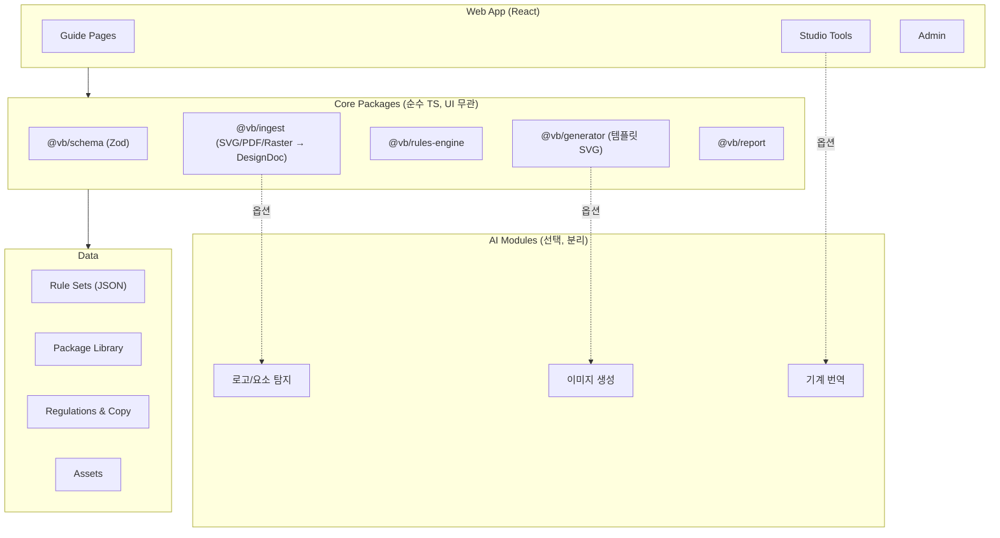

# ARCHITECTURE — 기술 아키텍처 · 데이터 구조 · Rule vs AI

> 관련: [PRD](./PRD.md) · [MVP-ROADMAP](./MVP-ROADMAP.md)

---

## 1. 권장 기술 스택

| 레이어 | 선택 | 이유 |
|---|---|---|
| 앱 | **React 18 + TypeScript + Vite** | 요구사항, 타입 안전한 룰 스키마 |
| 라우팅 | React Router | IA의 URL 구조 대응 |
| 상태 | Zustand (UI) + TanStack Query (데이터) | 단순, 서버 전환 용이 |
| 스타일 | CSS Modules + CSS 변수 디자인 토큰 | 브랜드 토큰을 JSON → CSS 변수로 생성 |
| 스키마 검증 | **Zod** | 룰/패키지 JSON 런타임 검증 + TS 타입 생성 |
| 캔버스/오버레이 | SVG + Konva.js (영역 지정·드래그) | 위반 박스, 수동 매핑 |
| 파일 파싱 | 브라우저 DOMParser(SVG), **pdf.js**(PDF 렌더·텍스트), Canvas(래스터 픽셀) | 서버 없이 처리 |
| 컬러 | culori (Lab, ΔE2000) | 검증된 구현 |
| 텍스트 측정 | Canvas `measureText` + opentype.js(폰트 메트릭) | 넘침 계산 |
| 리포트 | jsPDF (기존 의존성) | |
| 테스트 | Vitest (엔진 단위) + Playwright (E2E) | 엔진은 순수 함수 → 골든 테스트 |
| 백엔드 (Phase 2~) | Supabase (Postgres + Auth + Storage) 또는 사내 서버 | 승인·이력·권한 |
| 배포 | MVP: 정적 호스팅 (사내 or GitHub Pages private) | 비용 0 |

> [!NOTE]
> 현재 레포는 Vanilla JS + Vite 입니다. 기존 `engines.js`의 ΔE2000, 대비, 레이아웃 로직은 **TS로 이식해 재사용**하고, 페이지 코드는 React로 새로 작성합니다.

## 2. 시스템 구조



**원칙**
- `rules-engine`은 **입력(DesignDoc + RuleSet) → 출력(CheckResult)** 의 순수 함수. UI·네트워크 의존 없음 → 테스트·재현 가능.
- AI 모듈은 인터페이스(`ElementDetector`, `TranslationProvider`)로만 연결, 기본 구현은 "수동 입력". 꺼도 모든 기능이 동작.
- AI 결과도 반드시 `rules-engine`으로 재검수.

## 3. 디렉터리 구조 (제안)

```
apps/web/                  React 앱
  src/routes/guide/*  studio/*  admin/*
  src/components/          Canvas, OverlayBox, VerdictBadge, RuleRef...
packages/schema/           Zod 스키마 + 타입
packages/ingest/           svg.ts pdf.ts raster.ts → DesignDoc
packages/rules-engine/     checks/logo.ts color.ts typo.ts graphic.ts layout.ts locale.ts
packages/generator/
packages/report/
data/
  brand/vitalbeautie.json
  rulesets/{productLine}/{version}.json
  packages/{sku}/meta.json + images
  regulations/{country}.json
  copy/{country}/{sku}.json
  samples/                 ★ 모든 샘플 데이터 (sample: true)
```

## 4. 데이터 구조

### 4.1 공통 메타 (모든 규칙·기준값에 필수)
```ts
type Provenance = {
  status: 'sample' | 'draft' | 'approved' | 'deprecated';
  source?: string;        // 예: "BI Manual v3 p.12", "RA 2026-09 회신"
  approvedBy?: string;
  approvedAt?: string;    // ISO date
  validUntil?: string;
};
```
> 엔진 정책: `status !== 'approved'` 규칙의 판정에는 **DEMO** 배지. 법규 규칙은 approved가 아니면 `N/A`.

### 4.2 RuleSet
```ts
type RuleSet = {
  id: string; version: string; brandId: 'vitalbeautie';
  scope: { productLine?: string; touchpoint?: Touchpoint; country?: string };
  extends?: string;              // 공통 룰셋 상속 → 제품군별 오버라이드
  rules: Rule[];
  provenance: Provenance;
};

type Rule = {
  id: string;                    // 'LOGO.MIN_SIZE.PRINT'
  category: 'logo'|'color'|'typography'|'graphic'|'layout'|'regulation';
  title: string; description: string;
  check: CheckSpec;              // 엔진이 해석하는 선언형 조건
  severity: 'fail' | 'warn';
  guideRef?: string;             // '/guide/logo#min-size'
  provenance: Provenance;
};

type CheckSpec =
  | { type: 'minSize'; element: ElementRole; minMm?: number; minPx?: number }
  | { type: 'relativeSize'; element: ElementRole; ofReference: 'panelWidth'|'baseSpec'; range: [number, number]; tolerance?: number }
  | { type: 'zone'; element: ElementRole; allowed: ZoneId[] }
  | { type: 'clearSpace'; element: 'logo'; unit: 'logoHeight'; multiple: number }
  | { type: 'contrast'; element: ElementRole; minRatio: number }
  | { type: 'colorMatch'; element: ElementRole; palette: string; maxDeltaE: number }
  | { type: 'colorDistinct'; against: 'otherLines'; minDeltaE: number }
  | { type: 'toneBand'; L: [number, number]; C: [number, number] }
  | { type: 'fontFamily'; element: ElementRole; allowed: string[] }
  | { type: 'anchorAlign'; elements: ElementRole[]; tolerancePct: number }
  | { type: 'requiredText'; items: string[] }          // regulation
  | { type: 'minFontSize'; pt?: number; mm?: number; panelAreaCondition?: string };
```

### 4.3 DesignDoc (업로드 파일의 정규화 결과)
```ts
type DesignDoc = {
  id: string; sourceType: 'svg'|'pdf'|'raster';
  canvas: { widthMm?: number; heightMm?: number; widthPx: number; heightPx: number };
  spec?: { packageType: 'carton'|'tube'|'bottle'|'jar'; volume?: string; specId?: string };
  elements: DesignElement[];
  previewUrl: string;
};
type DesignElement = {
  role: 'logo'|'productName'|'graphic'|'infoArea'|'lineColorArea'|'certMark'|'other';
  bbox: { x: number; y: number; w: number; h: number };  // 캔버스 대비 0~1 정규화
  color?: string[]; fontFamily?: string; fontSizePt?: number; text?: string;
  extractedBy: 'svg-layer'|'pdf-object'|'manual'|'ai';
  confidence?: number;
};
```

### 4.4 ProductLine / Package Library
```ts
type ProductLine = {
  id: 'hydra'|'calm'|'bright'|string; name: string;
  lineColor: { hex: string; cmyk?: string; pantone?: string };
  ruleSetId: string; layoutTemplateId: string;
  specs: PackageSpec[];            // 규격 목록 (w/h mm, 기준 규격 여부)
  provenance: Provenance;
};
type ApprovedPackage = {
  sku: string; productLineId: string; specId: string;
  design: DesignDoc;               // 요소 좌표 포함 → D의 기준 데이터
  approvedAt: string; markets: string[];
};
```

### 4.5 Localization
```ts
type CountryRegulation = {
  country: 'KR'|'US'|'JP'|'CN'|'EU'|string;
  requiredItems: { id: string; label: string; languages: string[] }[];
  minFont?: { value: number; unit: 'pt'|'mm'|'inch'; condition?: string };
  certMarks?: string[];
  provenance: Provenance;          // ★ RA 승인 전에는 status:'sample'
};
type ApprovedCopy = { sku: string; country: string; lang: string; items: Record<string, string>; provenance: Provenance };
type LocaleTypo = { lang: string; fontStack: string[]; leading: { base: number; min: number }; tracking: { base: number; min: number }; minPt?: number };
type InfoAreaTemplate = { id: string; zones: { id: string; bbox: BBox; priority: number; expandable: boolean }[] };
```

### 4.6 CheckResult
```ts
type CheckResult = {
  id: string; tool: 'family-look'|'visibility'|'dna'|'localizer';
  ruleSetId: string; ruleSetVersion: string; createdAt: string;
  overall: 'pass'|'warn'|'fail';
  items: {
    ruleId: string; verdict: 'pass'|'warn'|'fail'|'na';
    measured?: Record<string, number|string>; expected?: Record<string, number|string>;
    elementRole?: string; bbox?: BBox;          // 위반 영역 표시용
    recommendation?: Recommendation;
    isDemo: boolean;                            // 미승인 규칙 기반 여부
  }[];
};
type Recommendation =
  | { type: 'colorChips'; chips: { hex: string; minDeltaE: number }[] }
  | { type: 'resize'; element: string; toBBox: BBox }
  | { type: 'swapVersion'; logoVersion: string }
  | { type: 'relayout'; params: { pt: number; leading: number; tracking: number } };
```

### 4.7 Approval (Phase 2, 백엔드)
```ts
type Approval = { id: string; targetType: 'localization'|'package'|'ruleSet'; targetId: string;
  status: 'requested'|'approved'|'rejected'; requestedBy: string; reviewer?: string;
  comments: { by: string; at: string; text: string }[]; history: { status: string; at: string }[] };
```

### 4.8 Pantone 이력 · 베네핏 컬러 (D-10~12)
```ts
type PantoneChip = { code: string; name?: string; lab: [number, number, number]; srgbApprox: string; library: 'Solid Coated'|'Solid Uncoated'|string };
// ★ 라이선스 데이터: 사내 export만 사용. 미확보 시 data/samples/pantone-sample.json

type PantoneUsage = { code: string; sku: string; productLineId: string; usage: 'lineColor'|'graphic'|'accent'; year: number; markets: string[] };

type BenefitColorMap = {
  benefit: 'hydration'|'soothing'|'brightening'|'firming'|'suncare'|string;
  hueRange: [number, number];      // LCh Hue (°)
  chromaRange?: [number, number];
  lightnessRange?: [number, number];
  provenance: Provenance;          // 브랜드 승인 전에는 sample
};
```
**제안 알고리즘 (Rule)**: Pantone 후보 전체 → ① 베네핏 Hue/C/L 범위 필터 → ② 브랜드 톤 밴드 필터 → ③ 기존 `PantoneUsage` 전체와 ΔE2000 ≥ 기준 → ④ 점수 = 베네핏 중심 근접도 × 최소 ΔE → 상위 3~5개. "학습"은 기존 사용 이력의 분포(사용 밀집 영역)를 통계로 반영.

### 4.9 국문 마스터 문안 (E-2a~c)
```ts
type MasterCopy = {
  sku: string; version: string;    // 국문 마스터 버전
  items: { itemId: string; ko: string }[];   // itemId: 'productName'|'netContent'|'ingredients'|'caution'|...
  provenance: Provenance;
};
type LocalizedCopy = {
  sku: string; country: string; lang: string;
  basedOnMasterVersion: string;    // 마스터 변경 감지용
  items: { itemId: string; text?: string; status: 'approved'|'needsTranslation'|'needsReview' }[];
  provenance: Provenance;
};
```
교체 로직: 마스터 `itemId` 순서·레이아웃 유지 → 국가 `LocalizedCopy`에서 같은 `itemId` 텍스트로 치환 → 국가 규정의 추가 필수 항목 삽입 → `basedOnMasterVersion`이 오래되면 `needsReview`.

### 4.10 Visual DNA 프로파일 (C-7~8)
```ts
type DnaProfile = {
  sourceAssets: string[];          // 학습에 쓴 승인 SVG id
  grid: number; strokeWidth: { mean: number; allowed: number[] };
  cornerRadius: { mean: number; allowed: number[] };
  lineCap: 'round'|'butt'|'square'; shapeMix: Record<'circle'|'capsule'|'rect'|'path', number>;
  fillRatio: number; palette: string[]; motifs: string[];   // 시그니처 모티프 SVG id
  provenance: Provenance;          // 추출 직후 draft → 관리자 승인
};
```

### 4.11 Auto Layout 규칙 (B-8, D 규격 베리에이션 공용)
```ts
type LayoutTemplate = {
  id: string; packageTypes: string[];          // carton, tube, bottle...
  elements: {
    role: 'logo'|'productName'|'graphic'|'infoArea';
    anchor: ZoneId;                            // 'top-center' 등
    size: { basis: 'panelWidth'|'panelHeight'; ratio: [number, number] };
    min?: { mm?: number; px?: number };
    order: number;                             // 공간 부족 시 우선순위
  }[];
  margins: { topPct: number; sidePct: number; gapPct: number };
  provenance: Provenance;
};
```
`layout-solver`: 패널 크기 입력 → 요소별 비율 범위·최소값·여백·clear space 제약을 만족하는 배치를 계산(비율 범위 내 후보 샘플링 → 제약 검사 → 점수화) → 2~3안. 동일 제약을 Checker가 검수에 재사용.

## 5. Rule 기반 vs AI 필요 기능 구분

| 기능 | Rule 기반 가능 | AI 필요 | 비고 / 대안 |
|---|---|---|---|
| 로고 크기·위치·여백 판정 | ✅ (요소 좌표가 있으면) | | 좌표 확보가 관건 |
| 배경 대비율·면적비 | ✅ 픽셀 계산 | | |
| 배경 복잡도 | ✅ 엣지 밀도(Sobel) | | 인지적 가시성은 근사치 |
| 적용안 2~3개 제안 | ✅ 후보 생성+점수 | | |
| 컬러 ΔE·톤밴드·추천칩 | ✅ | | |
| 규격별 비례·앵커 정렬 | ✅ | | |
| 서체 판정 | ✅ SVG/PDF 폰트명 | 래스터는 ❌ | 래스터는 수동 입력 |
| 필수 문안 누락 | ✅ 텍스트 매칭 | | PDF 텍스트 추출 필요 |
| 넘침·재배치 | ✅ 폰트 메트릭 계산 | | 실제 인쇄 조판과 오차 → 최종은 사람 확인 |
| 템플릿 기반 비주얼 초안 | ✅ 파라미터 SVG | | |
| 규격 입력 → 로고·제품명 자동 배치 (B-8) | ✅ 제약 기반 배치 | | 비정형 용기(곡면)는 전개도 기준 근사 |
| Pantone 이력 분석·베네핏 컬러 제안 (D-10~11) | ✅ Lab 필터 + ΔE | | Pantone 라이선스 데이터·베네핏 매핑 승인 필요 |
| 국문 마스터 → 국가별 문안 교체 (E-2a) | ✅ 항목 ID 치환 | 승인 번역이 없을 때만 ✅ | 번역본은 승인 라이브러리 우선 |
| 기존 아이콘 DNA 추출·유사 룩 생성 (C-7~8) | ✅ SVG 통계 + 도형 조합 | 복잡한 일러스트형은 ✅ | 단순 라인 아이콘까지는 Rule로 충분 |
| **래스터 이미지에서 로고/요소 자동 탐지** | | ✅ | MVP 대안: SVG 레이어명 규칙 + 수동 박스 |
| **사진형 무드/그래픽 생성** | | ✅ | MVP 대안: 템플릿 조합 |
| **번역 초안** | | ✅ | MVP 대안: 승인 문안 라이브러리, 번역은 외부 프로세스 |
| "브랜드다움" 정성 평가 | | ✅ (한계 큼) | 하지 않음, 정량 규칙만 |

> [!TIP]
> **요소 좌표 확보 전략 (D·B의 핵심 기술 과제)**
> 1. **SVG/AI 내보내기 시 레이어 네이밍 규칙** 지정 (`vb:logo`, `vb:product-name`, `vb:graphic`, `vb:info`) → 100% 자동 매핑. *가장 권장*
> 2. PDF: pdf.js로 텍스트·이미지 오브젝트 좌표 추출 → 역할은 사용자가 확인
> 3. PNG/JPG: 수동 박스 지정 (Konva) — 30초 내외 작업
> 4. (Phase 3) 템플릿 매칭(OpenCV.js) → 로고 위치 추정, 비용 0의 비-LLM 비전

## 6. 기술적 한계와 대안

| 한계 | 설명 | 대안 |
|---|---|---|
| AI(.ai) 파일 직접 파싱 | 독점 포맷, 브라우저 파싱 불안정 | PDF 호환 저장 또는 SVG 내보내기 요구 |
| 래스터 해상도 → 실측 mm | DPI 정보 신뢰 어려움 | 사용자 실측 크기 입력 필수 |
| 인쇄 컬러(CMYK/별색) 정확도 | 화면 RGB로 근사 | ΔE는 참고 지표, 최종은 컬러칩 실물 확인 문구 표기 |
| 텍스트 넘침 정확도 | 브라우저 렌더 ≠ 조판 프로그램 | 폰트 메트릭 기반 + 안전 여유 5% |
| 법규 최신성 | 규정은 수시 변경 | 출처·유효기간 필드, 만료 시 자동 WARN |
| 승인·협업 | 정적 사이트는 공유 저장 불가 | Phase 2 백엔드 도입 |

## 7. 보안·비용

- MVP: 업로드 파일은 **브라우저 메모리에서만 처리**, 서버 저장 없음, 외부 API 호출 없음.
- 유료 API(이미지 생성·번역·비전)는 Phase 3 이후, **사용량 상한 + 기능 플래그**로 도입.
