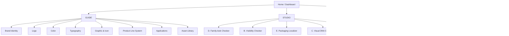

# IA — 정보 구조 및 메뉴 구성

> 관련: [PRD](./PRD.md) · [UX-FLOWS](./UX-FLOWS.md)

## 1. 설계 원칙

1. **Guide(읽기)와 Studio(작업)를 최상위에서 분리** — 상단 모드 스위치로 전환, 컬러·레이아웃 톤도 구분.
2. 참고 사이트처럼 **좌측 사이드바 + 섹션 앵커** 탐색을 유지 (Guide 영역).
3. Studio는 **좌측 입력 패널 / 중앙 캔버스 / 우측 결과 패널**의 작업형 3단 레이아웃.
4. 모든 화면에서 현재 **브랜드 · 제품군 · 룰셋 버전**이 보이도록 글로벌 컨텍스트 바 제공.
5. 가이드 규칙 ↔ 검수 결과가 서로 링크 (규칙 ID 기반 딥링크).

## 2. 사이트맵



## 3. 메뉴 상세

### 3.1 GUIDE (열람 · 전 사용자)

| 1depth | 2depth (섹션 앵커) | 데이터 소스 |
|---|---|---|
| Brand Identity | Story · Mission/Vision · Keywords · Tone of Voice | `brand.identity` |
| Logo | Primary / Symbol / Wordmark · Clear Space · Minimum Size · Color Versions · Misuse · 접점별 적용 | `rules.logo` |
| Color | Core Palette · Line Colors · Tone Band · 대비 조합표 · CMYK/Pantone | `rules.color` |
| Typography | 서체 · 위계 · 언어별 서체(KR/EN/JP/CN) · 행간/자간 규칙 | `rules.typography` |
| Graphic & Icon | Signature Motif · Icon Grid/Stroke · Pattern · Do/Don't | `rules.graphic` |
| Product Line System | 제품군별 컬러·레이아웃 템플릿·규격 | `productLines[]` |
| Applications | Package · Online(PDP/SNS/배너) · VMD | `applications[]` |
| Asset Library | 검색 · 필터(유형/제품군/포맷) · 다운로드 | `assets[]` |

### 3.2 STUDIO (작업 · 디자이너/담당자)

| 메뉴 | 하위 화면 | 권한 |
|---|---|---|
| **Family-look Checker** (PoC) | 새 검수 · 기준 패키지 선택 · 결과 · 리포트 | 디자이너 이상 |
| Visibility Checker | 업로드 · 로고 영역 지정 · 결과 · 제안 비교 | 디자이너 이상 |
| Packaging Localizer | SKU/국가 선택 · 문안 · 레이아웃 미리보기 · 검토 요청 | 글로벌 담당 이상 |
| Visual DNA Generator | 제품군·매체 선택 · 초안 · 검수 | 디자이너 이상 |
| Projects / Reports | 내 검수 이력 · 리포트 PDF | 본인/관리자 |

### 3.3 ADMIN (관리 · 브랜드 관리자)

| 메뉴 | 기능 |
|---|---|
| Rule Sets | 규칙 편집, 상태(draft/approved/deprecated), 출처·승인자 |
| Package Library | 승인 패키지 등록 (이미지 + 요소 좌표 메타) |
| Regulations & Copy | 국가별 필수 표시 항목·승인 문안 (RA 승인값만) |
| Approvals | E 승인 대기함, 승인/반려 |
| Change Log | 규칙·패키지 변경 이력, diff |

## 4. 글로벌 UI 요소

```
┌──────────────────────────────────────────────────────────────────────┐
│ VITALBEAUTIE  [ GUIDE | STUDIO | ADMIN ]   제품군 ▾  RuleSet v1.2 ●SAMPLE   🔍  👤 │
└──────────────────────────────────────────────────────────────────────┘
```
- **모드 스위치**: GUIDE / STUDIO / ADMIN (권한 없는 메뉴는 숨김)
- **컨텍스트**: 제품군 선택, 적용 중인 룰셋 버전, 데이터 상태 배지(`SAMPLE` / `APPROVED`)
- **검색**: 규칙·에셋·패키지 통합 검색

## 5. URL 구조

| 경로 | 화면 |
|---|---|
| `/` | Dashboard |
| `/guide/:section#:anchor` | 가이드 (예: `/guide/logo#clear-space`) |
| `/guide/assets?type=logo&line=hydra` | 에셋 라이브러리 |
| `/studio/family-look/new` · `/studio/family-look/:checkId` | D |
| `/studio/visibility/new` · `/:checkId` | B |
| `/studio/localizer/:skuId?country=JP` | E |
| `/studio/dna` | C |
| `/admin/rules/:ruleSetId` | 룰 편집 |
| `/rules/:ruleId` | 규칙 딥링크 (가이드 해당 위치로 이동) |

## 6. 사용자 유형별 진입점

| 사용자 | 첫 화면 위젯 |
|---|---|
| 브랜드 디자이너 | 최근 가이드 업데이트, 에셋, DNA Generator 바로가기 |
| 패키지 디자이너 | 내 검수 목록, "새 패밀리룩 검수" CTA |
| 글로벌 담당 | 국가별 SKU 진행 현황, 반려 건 |
| 브랜드 관리자 | 승인 대기, draft 규칙, 최근 FAIL 통계 |
