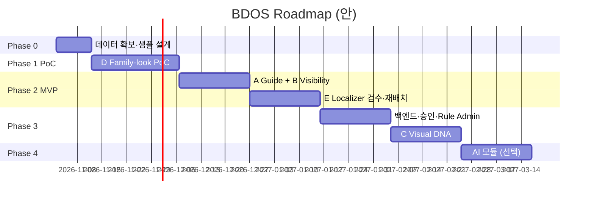

# MVP-ROADMAP — 난이도 · 우선순위 · MVP 범위 · 작업 목록

> 관련: [PRD](./PRD.md) · [ARCHITECTURE](./ARCHITECTURE.md)

---

## 1. 기능별 난이도 · 우선순위

난이도: ★ 쉬움 ~ ★★★★★ 어려움

| 기능 | 난이도 | 가치 | 데이터 의존 | 우선순위 | 비고 |
|---|---|---|---|---|---|
| A. Guide 열람·에셋 | ★★ | 中 | 브랜드 자료 | P0 (병행) | 콘텐츠 작업 비중 큼 |
| **D. Family-look (SVG/수동매핑)** | ★★★ | **高** | 승인 패키지 + 좌표 | **P0 · PoC** | 정량 판정 명확 |
| **D. Pantone 이력·베네핏 제안** | ★★★ | **高** | Pantone Lab 데이터, 사용 이력, 베네핏 매핑 | **P0 · PoC** | 라이선스 데이터 확보가 병목 |
| B. Auto Layout (규격 → 자동 배치) | ★★★ | 高 | 레이아웃 템플릿 | P1 | D와 `layout-solver` 공유 |
| E. 국문 마스터 자동 교체 | ★★ | 高 | 승인 번역 라이브러리 | P1 | |
| C. DNA 추출(기존 아이콘 학습) | ★★★★ | 中 | 승인 SVG 수십 개 | P2 | |
| B. Visibility (수동 영역) | ★★★ | 高 | 로고 규칙 | P1 | D의 캔버스/엔진 재사용 |
| E. 검수·재배치 | ★★★★ | 高 | **RA 승인 규정** | P1 | 규정 데이터 확보가 병목 |
| E. 승인 워크플로 | ★★★ | 中 | 백엔드 | P2 | |
| C. 템플릿 기반 생성 | ★★★★ | 中 | DNA 규칙 정의 | P2 | 규칙 정의 작업이 선행 |
| Rule Admin (폼 편집) | ★★★ | 中 | | P2 | MVP는 JSON 직접 편집 |
| 래스터 자동 탐지 (AI/CV) | ★★★★★ | 中 | 학습/샘플 | P3 | |
| 생성형 AI·기계번역 | ★★★★ | 低~中 | 외부 API | P3 | 비용 발생 |

## 2. 단계별 로드맵

| Phase | 기간(안) | 산출물 | 완료 기준 |
|---|---|---|---|
| **0. 준비** | 2주 | 샘플 데이터셋, 레이어 네이밍 규칙, 룰 스키마 | 스키마 Zod 검증 통과, 샘플 3라인×3규격 |
| **1. D PoC** | 4~5주 | Family-look Checker 단독 동작 | 샘플 20건 수동 판정 일치율 ≥ 85% |
| **2. MVP** | 6~8주 | Guide + B + E(검수·재배치) | 4개 시나리오(S1~S3, S5) E2E 통과 |
| 3. 운영화 | 6주 | 백엔드, 승인, Rule Admin, C | 승인 이력 저장, 권한 |
| 4. AI 확장 | 선택 | 자동 탐지, 생성, 번역 | 기능 플래그, 비용 상한 |

## 3. MVP 범위

### 포함 (In)
- React + TS 앱 골격, 디자인 토큰, 글로벌 바(GUIDE/STUDIO 모드)
- **D. Family-look Checker 전체 (D-1~D-9)**
- A. Guide: Identity, Logo, Color, Typography, Line System, Asset 다운로드
- B. Visibility: 업로드, 수동 로고 영역, 판정, 3안, 비교
- E. Localizer: SKU×국가, 필수 문안 적용, 누락·넘침·충돌 검수, 재배치 초안, PDF
- 리포트 PDF, 로컬 저장(IndexedDB) 기반 검수 이력
- 모든 데이터 `SAMPLE` / 미승인 규칙 `DEMO` 표기

### 제외 (Out) → 이후 단계
- 로그인·권한·다인원 승인 (E-5) → Phase 3
- Rule Admin 폼 편집 → Phase 3 (MVP는 JSON + 스키마 검증)
- C. Visual DNA Generator → Phase 3
- 래스터 자동 탐지, 생성형 AI, 기계 번역 → Phase 4
- .ai 원본 직접 파싱 → 지원 안 함 (SVG/PDF 내보내기)

## 4. PoC (Phase 1) 상세 작업 목록 — D. Family-look Checker

### 4.1 준비 (Phase 0)
- [ ] **T0-1** 샘플 브랜드 데이터: 가상 3개 라인(Hydra/Calm/Bright) × 3규격(15/30/50ml) — `data/samples/`
- [ ] **T0-2** 샘플 승인 패키지 SVG 9종 (레이어 네이밍 규칙 적용) + 의도적 위반 시안 11종 (총 20건 테스트셋)
- [ ] **T0-3** 테스트셋 정답지: 디자이너가 항목별 PASS/WARN/FAIL 수동 판정
- [ ] **T0-4** SVG 레이어 네이밍 규칙 문서화 (`vb:logo`, `vb:product-name`, `vb:graphic`, `vb:info`, `vb:line-color`)
- [ ] **T0-5** Zod 스키마: `RuleSet`, `Rule`, `CheckSpec`, `DesignDoc`, `ProductLine`, `ApprovedPackage`, `CheckResult`

### 4.2 기반
- [ ] **T1-1** Vite + React + TS 모노레포(pnpm workspace) 셋업, ESLint/Prettier, Vitest
- [ ] **T1-2** 디자인 토큰 (`tokens.json` → CSS 변수), 기본 컴포넌트: Button, Select, Panel, VerdictBadge, RuleRef, DemoBadge
- [ ] **T1-3** Studio 3단 레이아웃 셸

### 4.3 Ingest
- [ ] **T1-4** `ingest/svg.ts`: 레이어명 → role, bbox 정규화, fill 컬러, font-family/size, text
- [ ] **T1-5** `ingest/raster.ts`: 이미지 로드 + 수동 매핑용 데이터 구조
- [ ] **T1-6** 수동 영역 지정 UI (Konva: 박스 그리기·역할 지정·수정)
- [ ] **T1-7** (선택) `ingest/pdf.ts`: pdf.js 렌더 + 텍스트 좌표

### 4.4 Rules Engine
- [ ] **T1-8** 규격 정규화: 기준 규격 대비 스케일 계산
- [ ] **T1-9** `checks/logo.ts`: relativeSize, zone, anchorAlign
- [ ] **T1-10** `checks/color.ts`: ΔE2000(기존 코드 이식), toneBand, colorDistinct, 추천칩 생성
- [ ] **T1-11** `checks/typography.ts`: 제품명 fontFamily, 상대 크기, 위치
- [ ] **T1-12** `checks/graphic.ts`: 규격별 비례 ±tolerance
- [ ] **T1-13** `checks/layout.ts`: 존 앵커·여백·정렬
- [ ] **T1-14** 룰셋 상속(`extends`) + 제품군 오버라이드 해석기
- [ ] **T1-15** `isDemo` 판정 (provenance.status)
- [ ] **T1-16** 골든 테스트: 20건 테스트셋 vs 정답지 → 일치율 리포트 자동 산출

### 4.5 UI
- [ ] **T1-17** 새 검수: 제품군 → 기준 패키지(자동 추천) → 업로드
- [ ] **T1-18** 요소 매핑 확인 화면
- [ ] **T1-19** 결과 화면: 나란히/겹쳐보기, 위반 박스 오버레이, 항목 hover 연동
- [ ] **T1-20** 컬러 맵(Lab a*b* 평면) + 추천 칩
- [ ] **T1-21** 리포트 PDF + IndexedDB 이력

### 4.5b Pantone 제안 (D-10~12)
- [ ] **T1-24** `PantoneChip`/`PantoneUsage`/`BenefitColorMap` 스키마 + 샘플 데이터 (실제 Pantone 값 아님 표기)
- [ ] **T1-25** 승인 패키지의 Pantone 사용 이력 수집 화면 (라인·연도별 맵)
- [ ] **T1-26** 제안 엔진: 베네핏 범위 → 톤 밴드 → ΔE → 점수화, 근거 출력
- [ ] **T1-27** UI: 베네핏 선택 → 후보 3~5개, Lab 맵 위 기존 칩 vs 후보, 최근접 칩 ΔE 표시

### 4.6 검증
- [ ] **T1-22** 디자이너 3인 사용성 테스트 (S1 시나리오)
- [ ] **T1-23** 일치율·소요시간 측정 → Phase 2 진행 여부 결정

## 5. MVP (Phase 2) 작업 목록 요약

| ID | 작업 | 의존 |
|---|---|---|
| T2-1 | Guide 셸 (사이드바·앵커·On this page), 콘텐츠를 룰셋에서 렌더 | T0-5 |
| T2-2 | Logo/Color/Typo/Line System/Identity 페이지 | 브랜드 자료 |
| T2-3 | Asset Library (검색·필터·다운로드) | 에셋 |
| T2-4 | "이 규칙으로 검수" 딥링크 | T2-1 |
| T2-5 | B: 접점 프리셋, 업로드, 로고 영역 | T1-6 |
| T2-6 | B: 대비·면적비·복잡도·여백 판정 | 엔진 |
| T2-7 | B: 적용안 3개 생성·점수화, 슬라이더 비교, PNG 내보내기 | |
| T2-7a | B: **Auto Layout** — 규격 입력 → `layout-solver`로 로고·제품명 배치 2~3안, 치수 표기 SVG/PDF 내보내기 | T1-8, LayoutTemplate |
| T2-8 | E: SKU·국가 데이터 구조, 정보영역 템플릿 | 규정 데이터 |
| T2-8a | E: **국문 마스터 → 국가별 문안 자동 교체** (itemId 매핑, 미번역·재검토 표시) | MasterCopy |
| T2-9 | E: 필수 문안 매칭(누락), 최소 폰트(승인값만), 영역 충돌 | |
| T2-10 | E: 폰트 메트릭 기반 넘침 계산 + 재배치 알고리즘 | opentype.js |
| T2-11 | E: 다국어 나란히 미리보기, PDF | |
| T2-12 | E2E 테스트 (Playwright) | |

## 6. 기존 레포 처리 방안

현재 레포(Vanilla JS)는 아래처럼 처리합니다.
- `src/governance/engines.js` → 알고리즘(ΔE2000, 대비, wrap/autoLayout) **TS로 이식 후 테스트**
- `src/data/governance.js` → 규정·폰트 수치는 **미검증 값**이므로 `data/samples/`로 이동, `status: 'sample'`
- 기존 페이지 → 참고용으로 보관, 신규 앱은 `apps/web`에 작성

---

## 7. 검토가 필요한 핵심 의사결정

| # | 의사결정 | 선택지 | 권장 |
|---|---|---|---|
| 1 | 앱 구조 | (a) 기존 레포에서 React로 전환 (b) 신규 레포 | **(b) 같은 레포 내 `apps/web` 신규** — 기존은 아카이브 |
| 2 | 디자인 파일 입력 방식 | (a) SVG 레이어 네이밍 의무화 (b) PDF (c) PNG + 수동 | **(a) 기본 + (c) 보조**, 협력사 가이드 필요 |
| 3 | PoC 테스트 데이터 | (a) 가상 샘플 (b) 실제 승인 패키지 일부 | (a)로 시작, **가능한 빨리 (b) 5~10건 확보** |
| 4 | 판정 기준값 출처 | BI 매뉴얼 / 패키지팀 내부 기준 / 신규 정의 | 브랜드 관리자 승인 프로세스 확정 필요 |
| 5 | 법규 데이터 책임 | RA팀 / 글로벌 담당 / 외부 DB | **RA팀 승인값만**, 없으면 N/A |
| 6 | 백엔드 도입 시점 | MVP 포함 / Phase 3 | **Phase 3** (MVP는 로컬 저장) |
| 7 | 호스팅·보안 | GitHub Pages / 사내 서버 / 클라우드 | 미공개 패키지 고려 시 **사내 또는 private** |
| 8 | AI 모듈 도입 | 하지 않음 / Phase 4 선택 | Phase 4, PoC 결과 후 결정 |
| 9 | 대상 국가 1차 범위 | KR·US·JP·CN·EU 중 | 확인 필요 |
| 10 | 브랜드 서체·컬러 토큰 | 확정 자료 수령 | 수령 전까지 중립 토큰 사용 |
| 11 | Pantone 데이터 출처 | 사내 Pantone Connect export / 디자인팀 칩 목록 / 미사용 | **사내 라이선스 export** (없으면 기존 사용 칩 목록만으로 제한 운영) |
| 12 | 베네핏 ↔ 컬러 매핑 승인자 | 브랜드 관리자 / 디자인 리드 | 브랜드 관리자 승인 후 사용 |
| 13 | 국가별 승인 번역 문안 원천 | 현지 법인 / RA / 번역 업체 | 항목 ID 단위 엑셀 템플릿으로 수집 |
| 14 | C "학습" 방식 | SVG 통계(Rule) / 생성형 모델 | **SVG 통계로 시작**, 부족 시 Phase 4 AI |
