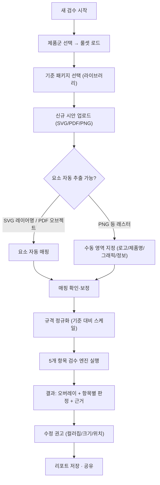
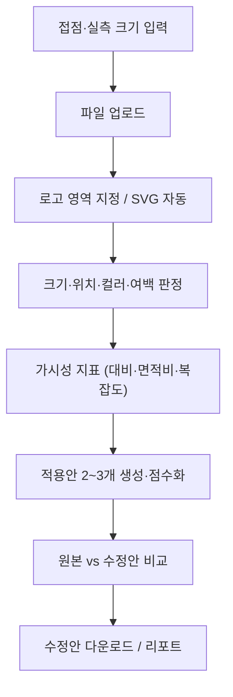
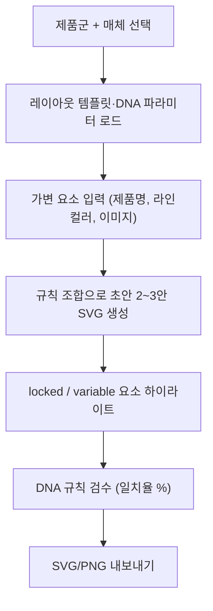
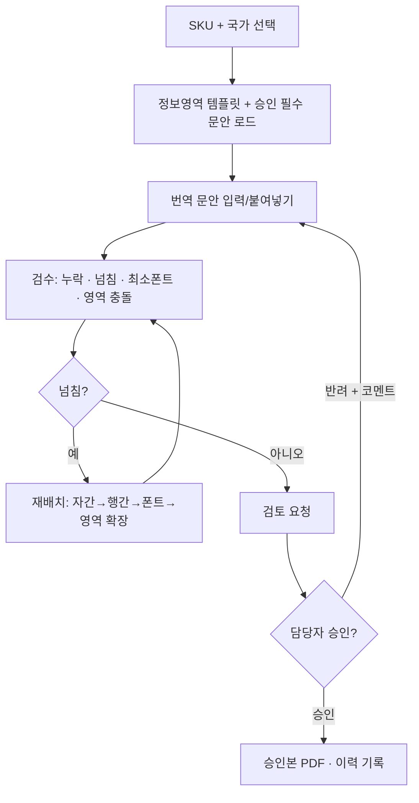
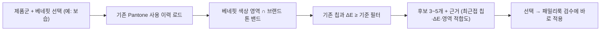
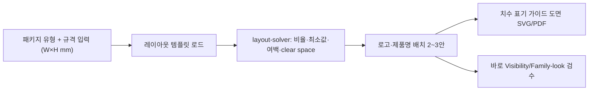
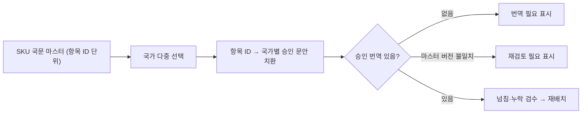
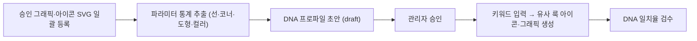

# UX-FLOWS — 사용자 시나리오 · 플로우 · 와이어프레임

> 관련: [PRD](./PRD.md) · [IA](./IA.md)

---

## 1. 사용자 유형별 시나리오

### S1. 패키지 디자이너 — 신규 SKU 패밀리룩 검수 (PoC)
> "하이드라 라인에 30ml 앰플이 추가됐다. 기존 50ml 세럼과 같은 라인으로 보이는지, 다른 라인과 컬러가 겹치지 않는지 확인하고 싶다."
1. Studio › Family-look Checker › 새 검수
2. 제품군 `Hydra` 선택 → 기준 패키지(50ml 세럼) 자동 추천
3. 신규 시안 SVG/PDF 업로드 → 요소(로고·제품명·그래픽·정보영역) 자동 매핑, 미매핑은 수동 박스 지정
4. 결과: 레이아웃 PASS, 컬러 WARN(Calm 라인과 ΔE 11) → 추천 컬러칩 3개
5. 리포트 PDF 저장 → 관리자에게 공유

### S2. 브랜드 디자이너 — 온라인 배너 로고 가시성 확인
1. Studio › Visibility Checker › 접점 `Online / PDP 배너` 선택, 1200×628px
2. 배너 PNG 업로드 → 로고 영역 드래그
3. 결과: 대비 2.8:1 FAIL, 크기 PASS → 화이트 로고 / 좌상단 이동 등 3안
4. 원본·수정안 슬라이더 비교 → 수정안 PNG 다운로드

### S3. 글로벌 디자인 담당자 — 일본 출시 라벨 대응
1. Studio › Localizer › SKU `VB-HY-SR-50` × 국가 `JP`
2. 승인된 일본 필수 문안 자동 삽입 → 번역 문안 입력
3. 넘침 경고 → 자동 재배치(행간 축소 → 폰트 한 단계) 초안 확인
4. 검토 요청 → 관리자 승인 → 승인본 PDF

### S4. 브랜드 관리자 — 규칙 변경과 승인
1. Admin › Rule Sets › 라인 컬러 허용 ΔE 기준 수정 (draft)
2. 변경 영향 미리보기 (기존 승인 패키지 중 재판정 결과 변화)
3. 승인 → 새 룰셋 버전 발행 → Change Log 기록

### S5. 협력사/신규 디자이너 — 가이드 열람
1. Guide › Logo › Clear Space 열람 → "이 규칙으로 검수" 버튼 → Visibility Checker로 이동
2. Asset Library에서 로고 SVG 다운로드

---

## 2. 기능별 사용자 플로우

### D. Family-look Checker (PoC)


### B. Visibility Checker


### C. Visual DNA Generator


### E. Packaging Localizer


---

## 3. 와이어프레임

### 3.1 Dashboard
```
┌ Global Bar ──────────────────────────────────────────────────────────┐
├──────────────────────────────────────────────────────────────────────┤
│  Good morning, 패키지 디자이너                                        │
│ ┌────────────────────┐ ┌────────────────────┐ ┌────────────────────┐ │
│ │ + 새 패밀리룩 검수  │ │ + 가시성 검수       │ │ + 로컬라이징        │ │
│ └────────────────────┘ └────────────────────┘ └────────────────────┘ │
│  최근 검수                                          승인 대기 (관리자) │
│  ┌ 썸네일 │ VB-HY-AM-30 │ Family-look │ WARN 2 │ 10/22 ┐  ┌───────┐ │
│  ┌ 썸네일 │ VB-CL-TN-150│ Localizer JP│ PASS   │ 10/21 ┐  │ 3건   │ │
│  가이드 업데이트: Color v1.2 – Line Tone Band 변경                    │
└──────────────────────────────────────────────────────────────────────┘
```

### 3.2 Guide 페이지 (참고 사이트 구조 계승)
```
┌ Global Bar ──────────────────────────────────────────────────────────┐
├────────────┬──────────────────────────────────────────┬──────────────┤
│ GUIDE      │  LOGO                                     │ On this page │
│ Identity   │  ┌──────────────────────────────────────┐ │ · Primary    │
│ ▸ Logo     │  │     [ 대형 로고 / 패키지 이미지 ]      │ │ · Clear Space│
│ Color      │  └──────────────────────────────────────┘ │ · Min Size   │
│ Typography │  Clear Space                     rule:LG-002│ · Versions  │
│ Graphic    │  [다이어그램]  로고 높이 X 기준 ...         │ · Misuse     │
│ Line System│  [ SVG ↓ ] [ PNG ↓ ] [ 이 규칙으로 검수 → ] │              │
│ Application│  Minimum Size                               │ ●SAMPLE 데이터│
│ Assets     │  ...                                        │              │
└────────────┴──────────────────────────────────────────┴──────────────┘
```

### 3.3 Family-look Checker — 결과 화면 (PoC 핵심)
```
┌ Global Bar ─────────────────────────────── Hydra ▾  RuleSet v0.1 SAMPLE ┐
├──────────────┬───────────────────────────────────────┬─────────────────┤
│ 입력          │  [기준 50ml]   [신규 30ml]   보기: ◉나란히 ○겹쳐보기   │ 결과  종합 WARN │
│ 제품군 Hydra  │  ┌─────────┐  ┌───────┐               │ ─────────────── │
│ 기준 패키지 ▾ │  │  LOGO   │  │ LOGO①│ ← 빨간 박스    │ ① 로고   PASS  │
│ 신규 시안 ⬆   │  │ ─────── │  │ ───── │               │   상대크기 0.98 │
│ 규격 30ml     │  │ graphic │  │graph②│               │ ② 그래픽 WARN  │
│               │  │  info   │  │ info  │               │   기대 24.1mm   │
│ 요소 매핑     │  └─────────┘  └───────┘               │   실제 27.0 +12%│
│ ☑ 로고        │                                       │ ③ 컬러   FAIL  │
│ ☑ 제품명      │  컬러 맵 (L*a*b*)                     │   Calm ΔE 9.8   │
│ ☑ 그래픽      │   ● 기존 라인  ◆ 신규                 │   추천: ■ ■ ■   │
│ ☑ 정보영역    │                                       │ ④ 제품명 PASS   │
│ [검수 실행]   │                                       │ ⑤ 레이아웃 PASS │
│               │                                       │ [리포트 PDF]    │
└──────────────┴───────────────────────────────────────┴─────────────────┘
```

### 3.4 Visibility Checker — 비교 화면
```
├──────────────┬───────────────────────────────────────┬─────────────────┤
│ 접점 PDP배너  │  ┌ 원본 ──────────┬── 수정안 A ──────┐ │ 지표            │
│ 1200×628px   │  │   [이미지]      │◀▶  [이미지]       │ │ 대비 2.8 FAIL   │
│ 로고영역 ⬚    │  └────────────────┴──────────────────┘ │ 크기 PASS       │
│              │  제안: [A 92점] [B 88점] [C 81점]       │ 여백 WARN       │
└──────────────┴───────────────────────────────────────┴─────────────────┘
```

### 3.5 Visual DNA Generator
```
├──────────────┬───────────────────────────────────────┬─────────────────┤
│ 제품군 Calm   │   [초안 A]   [초안 B]   [초안 C]       │ DNA 일치율 96%  │
│ 매체 SNS 1:1  │   🔒 로고·모티프·그리드 (회색 표시)     │ stroke  PASS    │
│ 제품명 ____   │   ✎ 컬러·제품명·이미지 (파랑 표시)      │ radius  PASS    │
│ [생성]        │                                       │ palette WARN    │
└──────────────┴───────────────────────────────────────┴─────────────────┘
```

### 3.6 Packaging Localizer
```
├──────────────┬───────────────────────────────────────┬─────────────────┤
│ SKU VB-HY-SR │  [KR 원본]   [JP]    [EN-US]           │ JP 검수         │
│ 국가 ☑JP ☑US │  ┌──────┐   ┌──────┐ ┌──────┐          │ 필수문안 5/5 ✔  │
│ 문안 편집 ▾  │  │      │   │ 넘침 │ │      │          │ 최소폰트 N/A*   │
│              │  └──────┘   └──────┘ └──────┘          │ 넘침 → 재배치안 │
│              │  재배치 로그: 행간 150→135%, 7→6.5pt    │ [검토 요청]     │
└──────────────┴───────────────────────────────────────┴─────────────────┘
 * 승인된 기준값이 없으면 N/A로 표시하고 판정하지 않음
```

## 4. UI 디자인 방향

| 항목 | 방향 |
|---|---|
| 톤 | 화이트 베이스 에디토리얼, 넉넉한 여백, 패키지 이미지가 주인공 |
| 컬러 토큰 | `--vb-core-*` (브랜드 확정 후 입력), `--vb-line-*` (제품군), `--status-pass/warn/fail` 은 브랜드 컬러와 분리 |
| 모드 구분 | GUIDE = 순백 + 큰 타이포 / STUDIO = 연회색 작업면 + 고밀도 패널 |
| 타이포 | 영문 브랜드 서체(확정 필요) + Pretendard/Noto Sans KR, JP, SC |
| 인터랙션 | 위반 항목 hover ↔ 캔버스 박스 동시 하이라이트, 결과 패널 접기 |
| 반응형 | Studio는 1280px 이상 권장, 미만에서는 결과 열람 전용 |

---

## 5. 추가 기능 플로우 (v0.2 피드백 반영)

### D+ Pantone 베네핏 제안

```
├──────────────┬───────────────────────────────────────┬─────────────────┤
│ 제품군 Hydra  │  Lab 맵:  ● 기존 사용 칩  ◆ 후보        │ 후보            │
│ 베네핏 ▾ 보습 │        [베네핏 영역 음영 표시]          │ ■ PMS ****  92점│
│ ΔE 기준 15   │                                       │   최근접 ΔE 18  │
│ [제안]        │  사용 이력: 라인 × 연도 칩 타임라인       │ ■ PMS ****  88점│
└──────────────┴───────────────────────────────────────┴─────────────────┘
 * Pantone 번호·값은 사내 라이선스 데이터 확보 전 SAMPLE로 표시
```

### B+ Auto Layout (규격 → 자동 배치)


### E+ 국문 마스터 자동 교체


### C+ 기존 제품 DNA 학습

